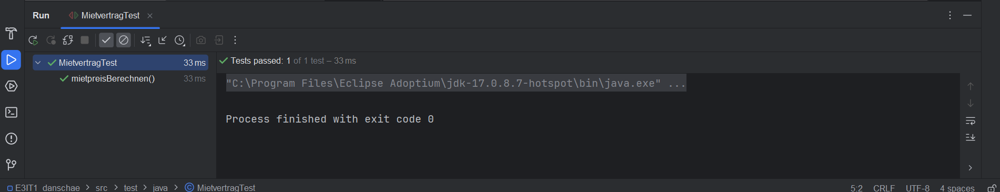
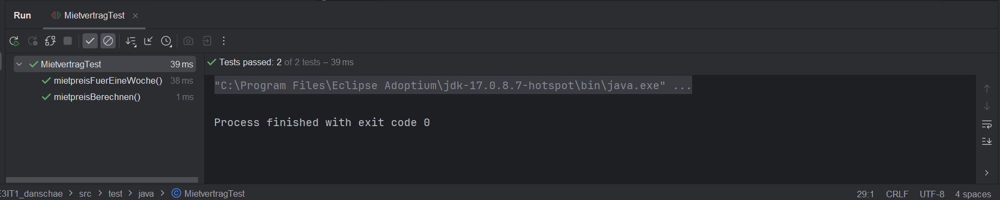
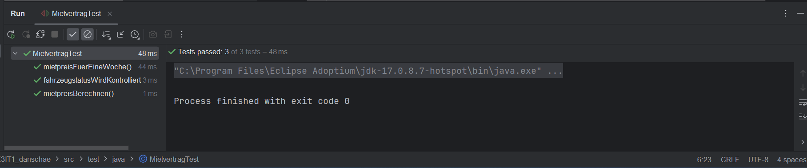
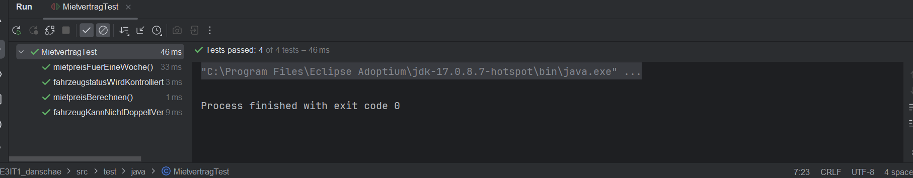
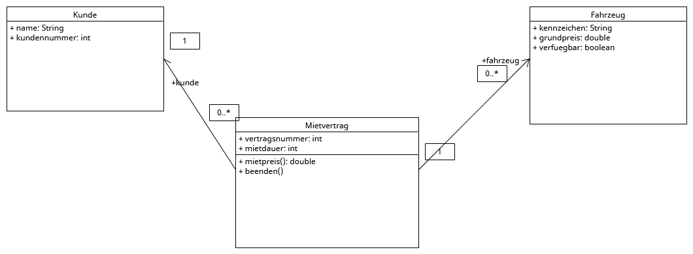
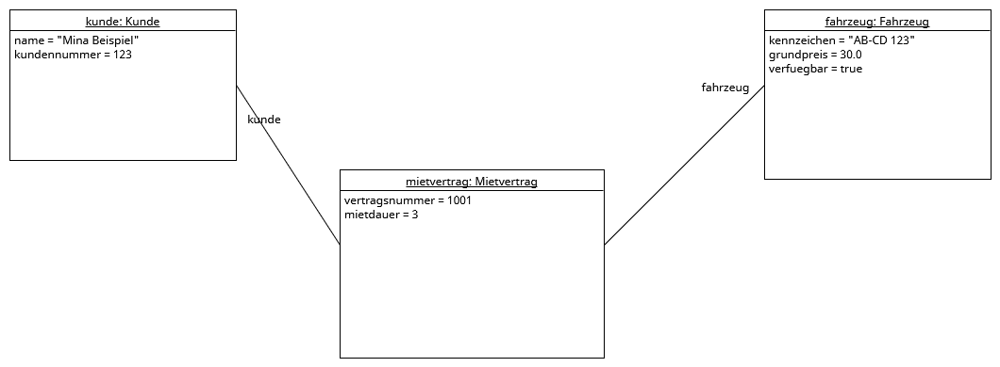
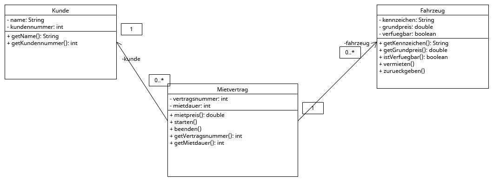
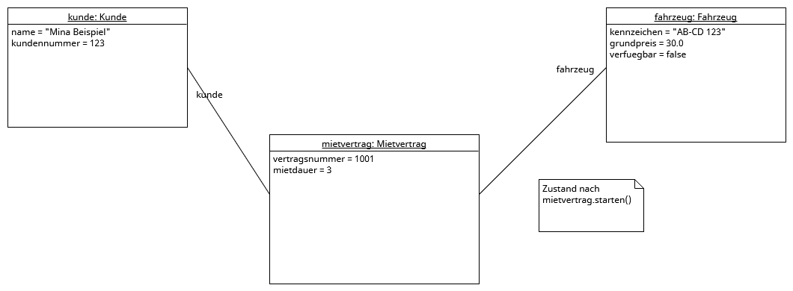

# Fahrzeugverleih

Schulprojekt (E3IT1, Projektkompetenz bei Herrn Frank):
Objektorientierte Konsolenanwendung in Java für einen Fahrzeugverleih.

## Aufbau
- `src/main/java/`: Klassen Kunde, Fahrzeug und Mietvertrag
- `src/test/java/`: JUnit-Tests
- `diagramme/`: Klassen- und Objektdiagramme (UMLet, .uxf und .png)
- `screenshots/`: Screenshots der Testausführung

## Tests ausführen
In IntelliJ: Rechtsklick auf `MietvertragTest` → *Run 'MietvertragTest'*
oder im Terminal: `mvn test`

## Entscheidungen

### Sprint 0
- Attribute sind in Java `private` und werden über Getter gelesen (Kapselung).

### Sprint 1
- `grundpreis` im Fahrzeug bedeutet den Preis **pro Tag**.
- `mietbeginn` und `mietende` wurden durch `mietdauer` (in Tagen) ersetzt,
  weil der vorgegebene Test nur eine Mietdauer übergibt. Mit beiden Varianten
  gleichzeitig könnten sich die Angaben widersprechen.
- Die Datentypen im Klassendiagramm wurden an Java angepasst
  (`String` statt `str`, `boolean` statt `bool`, `double` statt `float`).
- Der vorgegebene pytest-Test wurde in einen JUnit-5-Test übersetzt,
  weil das Projekt in Java umgesetzt ist. Kommazahlen werden mit einer
  Toleranz von 0.001 verglichen.

### Sprint 2
- Im Klassendiagramm sind alle Attribute jetzt mit `-` (private) gekennzeichnet,
  passend zum Code. Die Getter sind als Methoden eingetragen.
- Die Verfügbarkeit eines Fahrzeugs kann nur über die Methoden `vermieten()`
  und `zurueckgeben()` geändert werden. Es gibt bewusst **keinen Setter**
  `setVerfuegbar()`, damit der Zustand nicht beliebig von außen gesetzt werden kann.
- `vermieten()` prüft, ob das Fahrzeug verfügbar ist. Ist es bereits vermietet,
  wird eine `IllegalStateException` geworfen. So kann ein Fahrzeug nicht
  doppelt vermietet werden.
- Der Mietvertrag ändert das Fahrzeug nicht selbst: `starten()` ruft
  `fahrzeug.vermieten()` auf, `beenden()` ruft `fahrzeug.zurueckgeben()` auf.
- Der Getter `isVerfuegbar()` wurde in `istVerfuegbar()` umbenannt,
  passend zum vorgegebenen Test (`ist_verfuegbar()`).
- Das Objektdiagramm zeigt den Zustand direkt nach `mietvertrag.starten()`,
  weil dort die Statusänderung sichtbar wird (`verfuegbar = false`).

## Probleme und Lösungen
- Der Projektordner auf dem Desktop wurde in IntelliJ nicht angezeigt.
  Lösung: Pfad im Explorer kopiert und in IntelliJ eingefügt.
- Die Aufgaben für Sprint 1 standen zuerst nur als Kommentar in einem Issue
  und waren nicht mit dem Board verknüpft. Lösung: Issue dem Board zugeordnet
  und die Aufgaben als Sub-Issues angelegt.
- JUnit wurde in der pom.xml zuerst rot angezeigt.
  Lösung: Maven-Projekt neu geladen (Load Maven Changes).
- Im Objektdiagramm von Sprint 1 war die Verbindung zum Fahrzeug falsch
  beschriftet (`kunde` statt `fahrzeug`). Lösung: korrigiert und neu committet.
- Sprint 2: Das Issue „Sprint 2“ wurde zuerst ohne Unteraufgaben angelegt.
  Lösung: Die Aufgaben nachträglich als Sub-Issues ergänzt.

## Testergebnisse Sprint 1

Vorgegebener Test (Mietpreis 30,00 € × 3 Tage = 90,00 €):

Eigener Test (Mietpreis 45,50 € × 7 Tage = 318,50 €):

## Testergebnisse Sprint 2

Vorgegebener Test (Fahrzeugstatus ändert sich bei starten() und beenden()):

Eigener Test (ein vermietetes Fahrzeug kann nicht nochmal vermietet werden):

## Diagramme Sprint 1

## Diagramme Sprint 2

Klassendiagramm:

Objektdiagramm (Zustand nach `mietvertrag.starten()`):

