# Fahrzeugverleih

Schulprojekt (E3IT1, Projektkompetenz bei Herrn Frank):
Objektorientierte Konsolenanwendung in Java für einen Fahrzeugverleih.

## Aufbau
- `src/main/java/`: Klassen Kunde, Fahrzeug, Fahrrad, EBike und Mietvertrag
- `src/test/java/`: JUnit-Tests
- `diagramme/`: Klassen- und Objektdiagramme (UMLet, .uxf und .png)
- `screenshots/`: Screenshots der Testausführung

## Tests ausführen
In IntelliJ: Rechtsklick auf `MietvertragTest` → *Run 'MietvertragTest'*
oder im Terminal: `mvn test`

## Entscheidungen

### Sprint 0
- Attribute sind in Java `private` und werden über Getter gelesen (Kapselung).

### Sprint 1
- `grundpreis` im Fahrzeug bedeutet den Preis **pro Tag**.
- `mietbeginn` und `mietende` wurden durch `mietdauer` (in Tagen) ersetzt,
  weil der vorgegebene Test nur eine Mietdauer übergibt. Mit beiden Varianten
  gleichzeitig könnten sich die Angaben widersprechen.
- Die Datentypen im Klassendiagramm wurden an Java angepasst
  (`String` statt `str`, `boolean` statt `bool`, `double` statt `float`).
- Der vorgegebene pytest-Test wurde in einen JUnit-5-Test übersetzt,
  weil das Projekt in Java umgesetzt ist. Kommazahlen werden mit einer
  Toleranz von 0.001 verglichen.

### Sprint 2
- Im Klassendiagramm sind alle Attribute jetzt mit `-` (private) gekennzeichnet,
  passend zum Code. Die Getter sind als Methoden eingetragen.
- Die Verfügbarkeit eines Fahrzeugs kann nur über die Methoden `vermieten()`
  und `zurueckgeben()` geändert werden. Es gibt bewusst **keinen Setter**
  `setVerfuegbar()`, damit der Zustand nicht beliebig von außen gesetzt werden kann.
- `vermieten()` prüft, ob das Fahrzeug verfügbar ist. Ist es bereits vermietet,
  wird eine `IllegalStateException` geworfen. So kann ein Fahrzeug nicht
  doppelt vermietet werden.
- Der Mietvertrag ändert das Fahrzeug nicht selbst: `starten()` ruft
  `fahrzeug.vermieten()` auf, `beenden()` ruft `fahrzeug.zurueckgeben()` auf.
- Der Getter `isVerfuegbar()` wurde in `istVerfuegbar()` umbenannt,
  passend zum vorgegebenen Test (`ist_verfuegbar()`).
- Das Objektdiagramm zeigt den Zustand direkt nach `mietvertrag.starten()`,
  weil dort die Statusänderung sichtbar wird (`verfuegbar = false`).

### Sprint 3
- `Fahrzeug` ist jetzt die **Oberklasse** mit den gemeinsamen Eigenschaften
  (Kennzeichen, Tagespreis, Verfügbarkeit) und den Methoden aus Sprint 2.
- `Fahrrad` und `EBike` sind **Unterklassen** (`extends Fahrzeug`). Sie enthalten
  nur ihre eigenen Attribute (`anzahlGaenge` bzw. `akkukapazitaet`) und rufen
  im Konstruktor mit `super(...)` den Konstruktor von `Fahrzeug` auf.
- Die Klasse heißt `EBike` statt `E_Bike`, weil Klassennamen in Java
  nach Konvention ohne Unterstrich geschrieben werden (CamelCase).
- `grundpreis` wurde in `tagespreis` umbenannt (inkl. `getTagespreis()`),
  passend zur Anforderung und zum vorgegebenen Test.
- `Fahrzeug` ist **nicht abstrakt**, damit die Tests aus Sprint 1 und 2 mit
  `new Fahrzeug(...)` weiterhin unverändert funktionieren.
- Am `Mietvertrag` musste nichts geändert werden: Er arbeitet mit einem
  `Fahrzeug`, und Fahrrad und E-Bike *sind* Fahrzeuge.
- Die Akkukapazität wird als ganze Zahl in Wattstunden (Wh) gespeichert.
- Im Objektdiagramm stehen bei Fahrrad und E-Bike auch die geerbten Werte,
  weil die konkreten Objekte diese Werte besitzen. Beide Verbindungen vom
  Mietvertrag zum Rad heißen `fahrzeug`, weil das Attribut im Mietvertrag so heißt.

## Probleme und Lösungen
- Der Projektordner auf dem Desktop wurde in IntelliJ nicht angezeigt.
  Lösung: Pfad im Explorer kopiert und in IntelliJ eingefügt.
- Die Aufgaben für Sprint 1 standen zuerst nur als Kommentar in einem Issue
  und waren nicht mit dem Board verknüpft. Lösung: Issue dem Board zugeordnet
  und die Aufgaben als Sub-Issues angelegt.
- JUnit wurde in der pom.xml zuerst rot angezeigt.
  Lösung: Maven-Projekt neu geladen (Load Maven Changes).
- Im Objektdiagramm von Sprint 1 war die Verbindung zum Fahrzeug falsch
  beschriftet (`kunde` statt `fahrzeug`). Lösung: korrigiert und neu committet.
- Sprint 2: Das Issue „Sprint 2“ wurde zuerst ohne Unteraufgaben angelegt.
  Lösung: Die Aufgaben nachträglich als Sub-Issues ergänzt.
- Sprint 3: Die Aufgaben wurden als einzelne Issues statt als Sub-Issues angelegt.
  Lösung: Über „Add existing issue“ nachträglich unter „Sprint 3“ gehängt.
- Sprint 3: Nach dem Umbenennen von `getGrundpreis()` war `Mietvertrag` fehlerhaft.
  Lösung: Aufruf in `mietpreis()` auf `getTagespreis()` angepasst und mit den
  alten Tests geprüft, dass alles weiter funktioniert.

## Testergebnisse Sprint 1

Vorgegebener Test (Mietpreis 30,00 € × 3 Tage = 90,00 €):

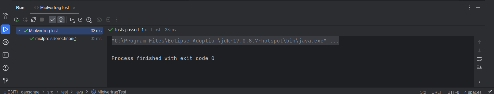

Eigener Test (Mietpreis 45,50 € × 7 Tage = 318,50 €):

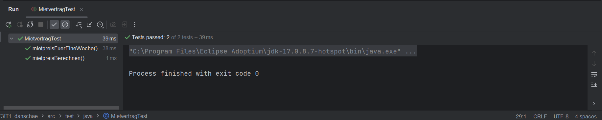

## Testergebnisse Sprint 2

Vorgegebener Test (Fahrzeugstatus ändert sich bei starten() und beenden()):

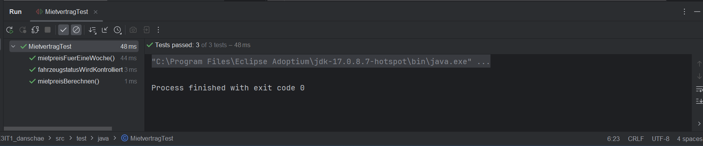

Eigener Test (ein vermietetes Fahrzeug kann nicht nochmal vermietet werden):

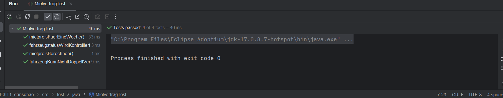

## Testergebnisse Sprint 3

Vorgegebener Test (Fahrrad 15,00 € × 3 = 45,00 €, E-Bike 30,00 € × 3 = 90,00 €):

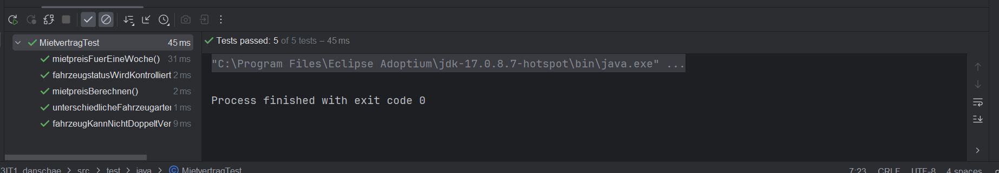

Eigener Test (E-Bike kann vermietet und zurückgegeben werden, 30,00 € × 2 = 60,00 €):

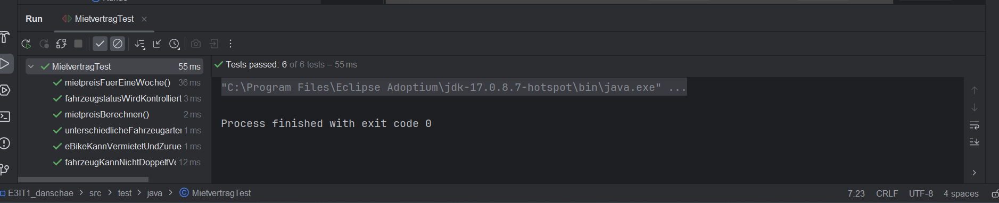

## Diagramme Sprint 1

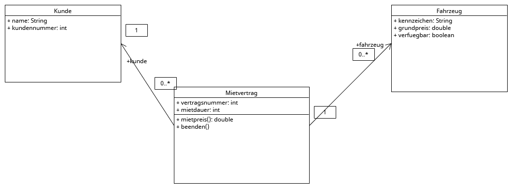

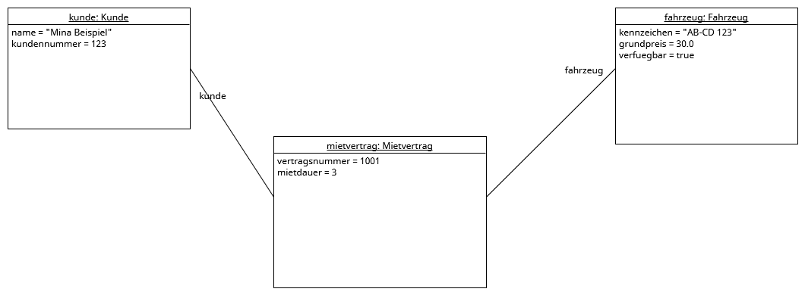

## Diagramme Sprint 2

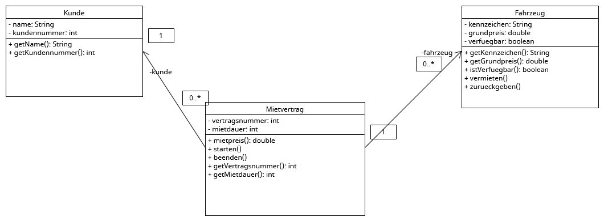

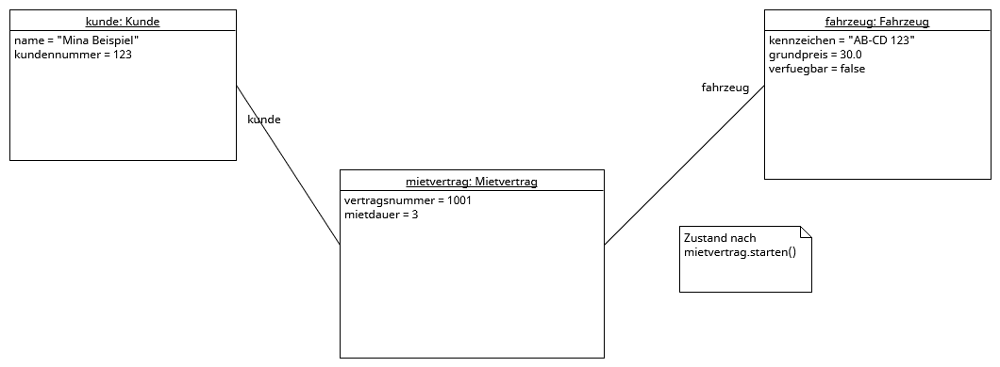

## Diagramme Sprint 3

Klassendiagramm mit Vererbung:

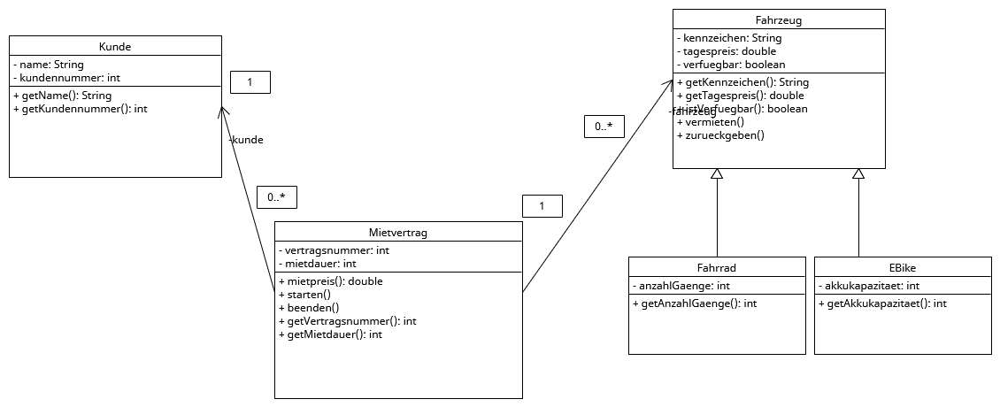

Objektdiagramm zum vorgegebenen Test:

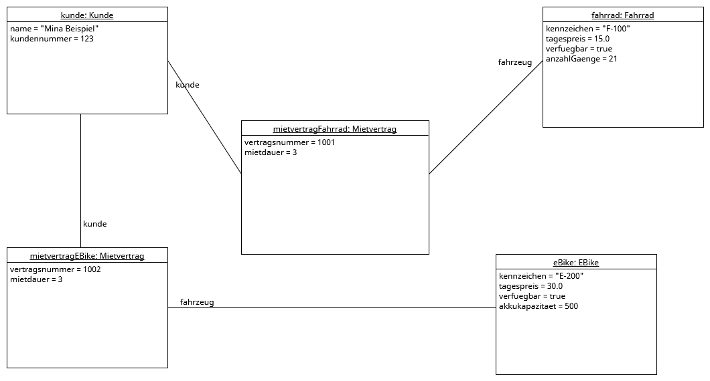

## Sprint 4

### Feedback von Herrn Frank umgesetzt
- Laut Klassendiagramm kann ein Mietvertrag mehrere Fahrzeuge enthalten.
  Bisher gab es nur ein Attribut `fahrzeug`. Jetzt speichert der Mietvertrag
  seine Fahrzeuge in einer Liste `List<Fahrzeug> fahrzeuge` (`ArrayList`).
  Eine Liste statt eines Arrays, weil die Anzahl der Fahrzeuge vorher nicht feststeht.
- Im Klassendiagramm von Sprint 4 sind bei allen Klassen die **Konstruktoren**
  ergänzt (die Diagramme von Sprint 1 bis 3 bleiben wie abgegeben).
- Im GitHub-Board wurde allen Issues von Sprint 1 bis 4 die passende
  **Iteration** zugeordnet. Sprint 0 (Vorbereitung) hat keine Iteration.

### Entscheidungen
- `Fahrzeug` ist jetzt **abstrakt**. Es gibt nur noch konkrete Fahrzeugarten
  (`Fahrrad`, `EBike`). Der Konstruktor von `Fahrzeug` ist `protected`,
  weil ihn nur noch die Unterklassen mit `super(...)` aufrufen.
  (Damit ist die Entscheidung aus Sprint 3, Fahrzeug nicht abstrakt zu machen, geändert.)
- `Fahrzeug` legt die abstrakte Methode `mietpreis(int mietdauer)` fest.
  Jede Unterklasse berechnet ihren Preis selbst (`@Override`):
  - `Fahrrad`: Tagespreis × Mietdauer
  - `EBike`: (Tagespreis + 5 € Akku-Servicepauschale) × Mietdauer.
    Die 5 € sind eine Konstante (`static final`), weil sie für alle E-Bikes gleich sind.
- **Polymorphie:** `gesamtpreis()` im Mietvertrag ruft für jedes Fahrzeug der Liste
  dieselbe Methode `mietpreis(mietdauer)` auf, ohne zu wissen, welche Fahrzeugart
  es ist. `gesamtpreis()` ersetzt die bisherige Methode `mietpreis()` des Mietvertrags.
- Neue Methode `hinzufuegenFahrzeug(Fahrzeug)`. Der Konstruktor bekommt weiterhin
  ein erstes Fahrzeug, deshalb hat ein Vertrag immer mindestens ein Fahrzeug (`1..*`).
- `starten()` prüft zuerst, ob **alle** Fahrzeuge verfügbar sind, und vermietet
  erst dann alle. So wird entweder alles oder nichts vermietet.
- `getFahrzeuge()` gibt eine nicht veränderbare Kopie der Liste zurück
  (`List.copyOf`), damit Fahrzeuge nur über `hinzufuegenFahrzeug()` in den
  Vertrag kommen (Kapselung).
- Im Klassendiagramm sind Klasse und Methode `mietpreis` von `Fahrzeug` kursiv
  (abstrakt), die Konstante ist unterstrichen (statisch). Ein Mietvertrag hat
  `1..*` Fahrzeuge, ein Fahrzeug kann in `0..*` Mietverträgen vorkommen.
- **Bisherige Tests angepasst:**
  - `new Fahrzeug(...)` geht nicht mehr, weil `Fahrzeug` abstrakt ist.
    Dort wird jetzt ein `Fahrrad` verwendet, das genauso rechnet,
    deshalb bleiben die erwarteten Preise gleich.
  - `mietpreis()` wurde in den Tests durch `gesamtpreis()` ersetzt.
  - Wegen der neuen E-Bike-Regel ändern sich zwei erwartete Preise:
    3 Tage 90 € → 105 €, 2 Tage 60 € → 70 €.
- Im Objektdiagramm sind beide Räder mit **einem** Mietvertrag verbunden.
  Beide Verbindungen heißen `fahrzeuge`, weil beide in derselben Liste liegen.

### Probleme und Lösungen
- Nachdem `Fahrzeug` abstrakt wurde, waren die alten Tests mit `new Fahrzeug(...)` rot.
  Das war erwartet. Lösung: Tests nach dem Umbau des Mietvertrags angepasst,
  danach waren alle wieder grün.
- Im Klassendiagramm wurde beim Ändern der Multiplizitäten versehentlich auch die
  Zahl beim Kunden auf `1..*` gesetzt. Lösung: wieder auf `1` korrigiert.
- Im Objektdiagramm wurden die Linien als Text `lt=- r2=fahrzeuge` angezeigt,
  weil beim Einfügen Leerzeichen am Zeilenanfang mitkopiert wurden.
  Lösung: Text ohne Leerzeichen neu eingegeben.
- Der Commit „Alte Tests angepasst und vorgegebenen Test Sprint 4 umgesetzt“
  enthielt nur die angepassten Tests. Der vorgegebene Test folgte im nächsten Commit.

### Testergebnisse Sprint 4

Vorgegebener Test (Fahrrad 15 € × 3 = 45 € + E-Bike (30 € + 5 €) × 3 = 105 € → 150 €):

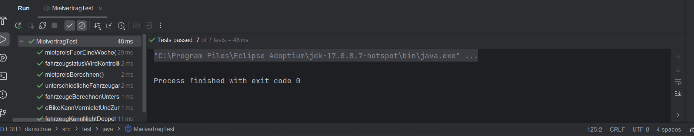

Eigener Test (ist ein Fahrzeug schon vermietet, startet der Vertrag nicht und das
E-Bike bleibt frei; Gesamtpreis 70 € + 30 € = 100 €):

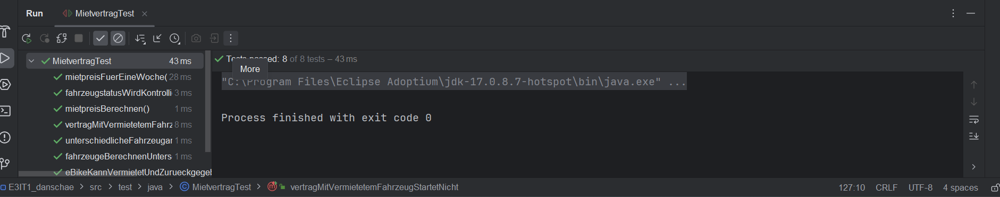

### Diagramme Sprint 4

Klassendiagramm (Fahrzeug abstrakt, Liste, Konstruktoren):

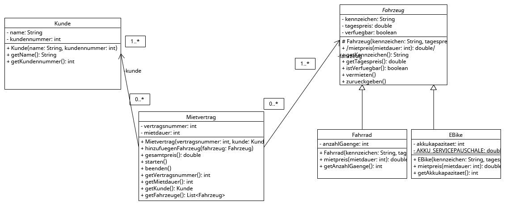

Objektdiagramm zum vorgegebenen Test (ein Vertrag mit Fahrrad und E-Bike):

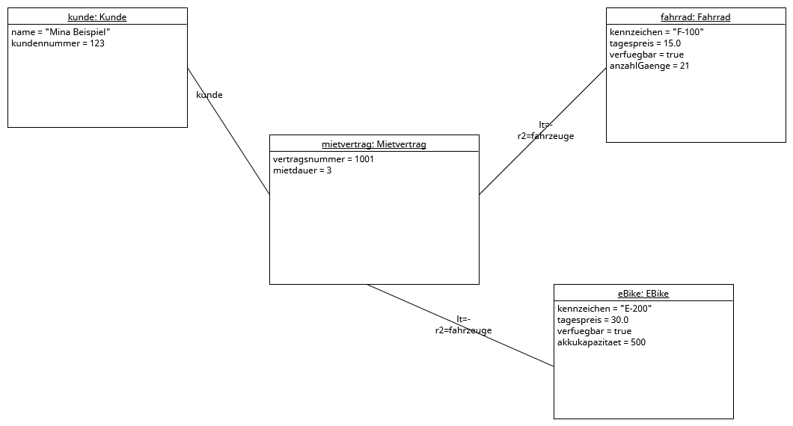